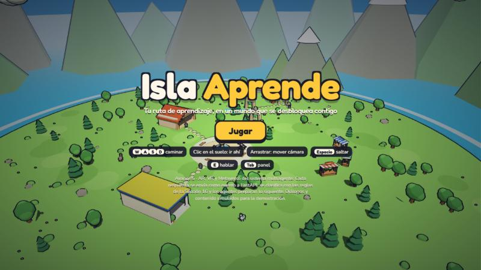
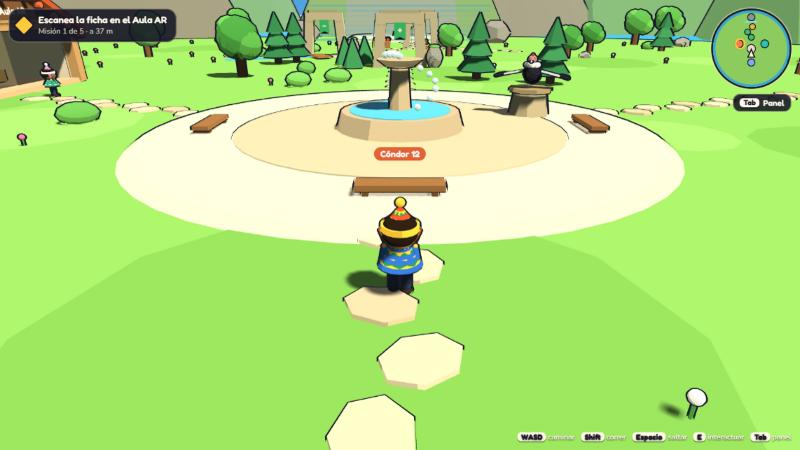
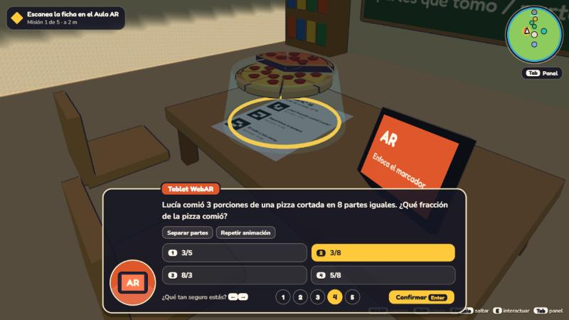
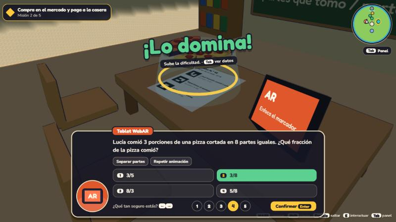
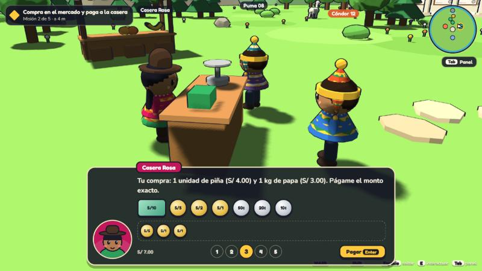
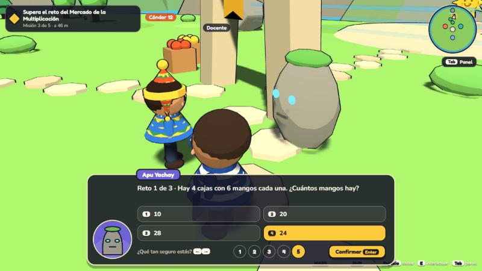
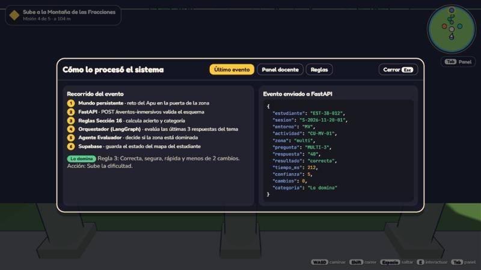

# Isla Aprende 3D

Prototipo demostrativo del **Avance 5 (AR, VR y Metaverso)** del proyecto *Desarrollo de un sistema multiagente basado en IA para la personalización de contenido pedagógico en estudiantes del nivel primario de instituciones educativas de Lima, 2026*, del curso Herramientas de Desarrollo Profesional TIC.

**Jugar en línea:** https://giuseppi05.github.io/learn-island/



## Qué es

Isla Aprende es un mundo 3D persistente con estética cel-shading. El estudiante, representado por un avatar con alias (Cóndor 12), recorre una isla andina en la que cada zona corresponde a un caso de uso inmersivo del informe:

| Zona | Caso de uso | Qué hace el estudiante |
| --- | --- | --- |
| Aula AR | CU-AR-01 · Fichas de trabajo aumentadas | Escanea el marcador de la ficha, manipula un holograma 3D de la fracción y responde con su nivel de confianza. |
| Mercado virtual | CU-VR-02 · Mercado virtual para resolver problemas | Recoge los productos de su lista y paga con billetes y monedas en soles. La dificultad sube o baja según su desempeño. |
| Ruta de aprendizaje | CU-MV-01 · Aula virtual persistente con rutas personalizadas | Supera los retos de los Apus en cada puerta. Al dominar una zona se desbloquea la siguiente; si tiene dificultades, aparece una zona de refuerzo. |
| Galería de logros | CU-MV-03 · Exposición virtual de logros para familias | Muestra a la familia el avance del estudiante y un reporte en lenguaje sencillo. |

Cada respuesta se envía como un evento con los mismos campos del mando físico (`respuesta`, `tiempo_ms`, `confianza`, `cambios`), más `entorno` y `actividad`, y se clasifica con las cuatro reglas de la Sección 16 (Entendió mal, No sabe el tema, Lo domina, Le falta práctica). La tecla **Tab** abre el panel con el recorrido del evento por FastAPI, el Orquestador, los agentes y Supabase, junto con el panel docente.

## Controles

| Acción | Teclado y ratón | Celular |
| --- | --- | --- |
| Caminar | W A S D o flechas, o clic en el suelo | Joystick |
| Correr | Shift | — |
| Saltar | Espacio | Botón Saltar |
| Interactuar o avanzar diálogo | E, Enter o clic | Botón Usar |
| Responder | Teclas 1 a 4, confianza con ← y → | Tocar opciones |
| Panel del sistema y docente | Tab | Botón Panel |

## Alcance

Es un prototipo conceptual: los textos de los agentes, el guía Amaru y los datos de los compañeros están simulados. Los eventos se generan en el navegador y no se envían a un servidor.

## Tecnología

Una sola página HTML con [three.js r128](https://threejs.org/) (MeshToonMaterial, OutlineEffect y BufferGeometryUtils), sin proceso de compilación. Para ejecutarlo localmente basta con abrir `index.html` en un navegador con conexión a internet.

## Capturas

| | |
| --- | --- |
|  |  |
|  |  |
|  |  |

## Rama de prueba: modelos KayKit

En la rama `prueba-modelos-kaykit` los personajes, árboles, rocas, casas y parte de la comida del mercado usan modelos de los packs **KayKit** de Kay Lousberg ([kaylousberg.com](https://kaylousberg.com)), con licencia CC0. Están en `assets/kaykit/` junto con su licencia. Si los modelos no cargan, el juego vuelve a las piezas procedurales de la rama `main`.

Para probarla en local hace falta un servidor, porque el navegador no carga modelos desde `file://`:

```bash
python -m http.server 8765
```
